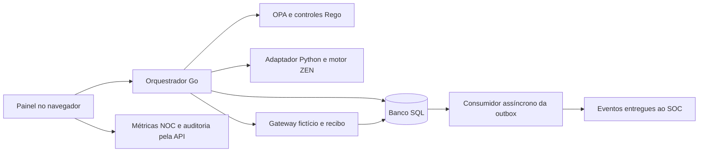

# Finslet · Projeto Bancário

Sistema acadêmico de prevenção a fraudes em cartões e transferências fictícias. Cada pedido passa por controles obrigatórios e por uma tabela de risco. O painel mostra o resultado, o saldo disponível, a reserva, o motivo e a versão da regra aplicada.

**Equipe:** Luiz Eduardo, Gabriel Martiniano, Guilherme e Paulo Renato. **Disciplina:** Paradigmas de Programação. [Repositório da equipe](https://github.com/BaianoZueiro/Projeto-Bancario).

## Telas da central antifraude

| Tela | O que demonstrar |
|---|---|
| Simulador | Escolher um cenário, executar a operação e comparar decisão, saldo disponível e reserva. |
| Auditoria | Filtrar as últimas 60 operações por decisão ou buscar ID, cliente e destino. Em **Detalhes**, consultar evidências, reconciliar ou abrir contestação. |
| NOC | Acompanhar latência p95, erros e fila. Pausar a entrega ao SIEM e observar a retomada. |
| SOC | Filtrar os eventos entregues por risco, acesso negado ou contestação. Testar a permissão de política e abrir as operações associadas aos eventos. |
| Contestações | Consultar protocolos, ler o relato registrado e voltar aos detalhes da operação de origem. |

A navegação preserva o formulário e aceita Voltar/Avançar do navegador. Veja o [relatório técnico ilustrado em PDF](output/pdf/Finslet_Relatorio_do_Projeto.pdf) para acompanhar o fluxo, o código e os resultados dos testes.

## Executar para a apresentação

**No computador preparado da equipe**, abra `Iniciar.cmd` ou execute `.\Iniciar.cmd` no terminal do VS Code. O navegador abre o [painel local](http://127.0.0.1:8090). O inicializador usa Go, OPA e o interpretador Python com a biblioteca ZEN instalados localmente. O histórico fica em `.data/finslet.db` (SQLite). As portas locais são 8090 para a API, 8181 para OPA e 8182 para ZEN. Se a aplicação já estiver ativa, o atalho abre o painel existente.

**Em outro computador**, com Docker e o plugin Compose disponíveis, use:

```sh
git clone https://github.com/BaianoZueiro/Projeto-Bancario.git
cd Projeto-Bancario
docker compose up --build
```

Abra o mesmo endereço após a inicialização dos serviços. Nesse modo o banco é **PostgreSQL 16**, com volume persistente. A primeira construção baixa imagens e dependências. Para encerrar, use `docker compose down` na pasta do projeto. Na execução nativa em primeiro plano, use Ctrl+C no terminal do inicializador.

**Alternativa Windows após clonar**, instale Go 1.25, OPA 1.9 e Python 3.12 no PATH. No PowerShell, execute `python -m pip install zen-engine==0.50.0`, defina `$env:FINSLET_PYTHON=(Get-Command python).Source` e abra `.\Iniciar.cmd`. Para usar seu próprio PostgreSQL, configure `DATABASE_URL` com uma base exclusiva do projeto antes de iniciar. A aplicação cria o esquema e quatro contas fictícias.

## Roteiro de demonstração

| Etapa | O que fazer no painel | O que explicar ao professor |
|---|---|---|
| 1. Pagamento habitual | Execute o cenário padrão de Bruno (R$ 150). Clique em **Reenviar a última solicitação**. | A primeira execução debita R$ 150. O reenvio mostra a mesma chave e o saldo permanece igual ao observado após o primeiro débito. |
| 2. Controle obrigatório | Selecione **Teto pessoal de Ana**, mantenha R$ 1.200 e desmarque **Dispositivo cadastrado**. Execute. Marque o dispositivo e execute novamente. | A primeira recusa registra DISPOSITIVO. A segunda registra TETO_PESSOAL. A ordem vem do Rego, e a tabela de risco só é consultada se os controles anteriores passarem. |
| 3. Fracionamento | Selecione **Três Pix fracionados** e digite um destino inédito, como `feira2`. Execute uma vez. | O cenário gera três pedidos diferentes de R$ 190. O terceiro atinge a regra de frequência e soma. Em **Detalhes**, mostre a contagem, o acumulado em centavos e a versão de risco. |
| 4. Coação e erro de classificação | Execute os dois cenários de coação. Abra os detalhes de uma operação em análise e registre uma contestação. | Valor muito atípico e favorecido novo justificam revisão. Uma pessoa coagida que usa aparelho habitual, valor habitual e MFA pode passar pelos controles. O protocolo preserva o relato. |
| 5. Rede lenta | Execute **Resposta tardia do gateway**. Observe a reserva. Reenvie, abra **Detalhes** e clique em **Consultar recibo do gateway**. | O reenvio preserva a reserva. A confirmação converte a reserva em lançamento contábil. O dinheiro disponível fica igual antes e depois da confirmação, pois a reserva já o comprometia. |
| 6. Continuidade | Pause a entrega ao SIEM, faça uma operação, veja a fila e retome a entrega. Execute **Motor obrigatório indisponível**. | O consumidor retoma eventos persistidos. Já a falha do controle obrigatório coloca o pedido em análise, sem débito. |
| 7. Atomicidade | Execute **Erro SQL antes do commit**. Compare o saldo e a quantidade de operações antes e depois. | Uma violação real de chave interrompe a transação SQL. O rollback abrange pedido, recibo, lançamentos e evento. O contador de erros internos sobe. |

O histórico acumula tentativas anteriores. Em ensaios de frequência Pix, troque o destino para começar uma janela limpa. Compras usam um cartão fictício por cliente e contam as tentativas desse cartão no último minuto.

## Arquitetura e paradigmas



| Paradigma | Onde aparece | Por que foi escolhido |
|---|---|---|
| Imperativo | `submit`, `reconcile` e `dispute` em Go | O fluxo financeiro precisa de uma ordem verificável. Consultar regras, reservar, lançar e confirmar em sequência torna os efeitos e as falhas explícitos. |
| Declarativo | Rego, tabela de decisão JSON do ZEN e consultas SQL | A equipe descreve as condições de recusa, os critérios de risco e os dados desejados. Dá para revisar uma regra sem reescrever o fluxo de débito. |
| Funcional | `riskFacts` | A função transforma perfil, pedido e histórico em sinais sem depender de relógio, rede ou banco. As mesmas entradas reproduzem o resultado. |
| Concorrente | Servidor HTTP Go e ensaios com goroutines | Pedidos chegam simultaneamente. A chave única, a transação e o bloqueio da conta preservam a consistência. O protótipo limita conexões ao banco por processo para simplificar a demonstração. |
| Orientado a eventos | Tabela `events`, rotina `publish` e painel SOC | A decisão e o evento são gravados no mesmo commit. A entrega ao SOC ocorre depois e pode ser pausada e retomada. |

## Guia do código

| Arquivo | O que ler ou demonstrar |
|---|---|
| [main.go](main.go) | `main` seleciona o banco, inicia o consumidor de eventos e serve a interface embutida no binário. `routes` liga botões a métodos HTTP. `dashboard` calcula saldos, reservas, fila e p95. `publish` entrega os eventos pendentes quando o SIEM está ativo. |
| [store.go](store.go) | `submit` compara a chave ao pedido anterior, carrega a janela de tentativas, aplica OPA e ZEN e grava a decisão. `balance` desconta as reservas. `book` cria débito e crédito em centavos. `reconcile` consulta o recibo persistido. `dispute` gera um protocolo único por operação. |
| [engines.go](engines.go) | `riskFacts` calcula sinais do produto. `evaluate` controla tempo máximo, codifica o contexto e interpreta a resposta de cada motor. |
| [controls.rego](policy/controls.rego) | OPA avalia conta, MFA, dispositivo e teto pessoal, nessa ordem. O resultado contém um motivo e uma versão. Os tetos são exemplos didáticos. |
| [risk.json](policy/risk.json) | Grafo executável do ZEN. A primeira linha aplicável da tabela decide entre frequência de cartão, Pix fracionado, valor atípico, combinação de região e destino ou operação habitual. |
| [service.py](policy/service.py) | Carrega o grafo no ZEN e oferece o endpoint interno `/evaluate` usado pelo Go. |
| [schema.sql](schema.sql) | Define os clientes, operações, lançamentos, recibos, eventos, contestações e controle de entrega. As chaves primárias impedem repetir um pedido ou lançar duas vezes na mesma conta para a mesma operação. |
| [index.html](web/index.html), [style.css](web/style.css) e [app.js](web/app.js) | O HTML organiza simulador, auditoria e monitoramento. O CSS adapta o painel ao tamanho da tela. O JavaScript monta os cenários, gera a chave, conserva o pedido para reenvio e atualiza o painel a cada 2,5 segundos. |
| [screens.js](web/screens.js) | Controla a navegação, os filtros da auditoria e do SOC, os indicadores do NOC e a lista de protocolos. |
| [store_test.go](store_test.go) e [integration_test.go](integration_test.go) | Exercitam rollback, precedência, falhas, contestações, retomada após reinício, classificação e carga. Os testes de banco criam dados isolados da demonstração. |
| [Iniciar.cmd](Iniciar.cmd) e [Iniciar.ps1](Iniciar.ps1) | Abrem o projeto no Windows, verificam a prontidão dos motores e compilam a API antes da demonstração. |
| [compose.yaml](compose.yaml), [Dockerfile](Dockerfile) e [policy/Dockerfile](policy/Dockerfile) | Definem os quatro serviços da versão PostgreSQL e as imagens da API e do adaptador ZEN. [go.mod](go.mod) e [go.sum](go.sum) registram as dependências Go e suas verificações de integridade. |

## API e consistência

| Método e rota | Efeito |
|---|---|
| `POST /transacoes` | Recebe um pedido JSON com ID, cliente, produto, destino, valor em centavos e sinais fictícios. Mesma chave e mesmo conteúdo retornam o estado atual. Mesma chave com conteúdo diferente retorna HTTP 409. |
| `GET /transacoes/{id}` | Consulta o estado, motivo e evidências. |
| `POST /transacoes/{id}/reconciliar` | Consulta o recibo simulado e, se necessário, liquida a reserva uma vez. |
| `POST /transacoes/{id}/contestar` | Recebe `{"note":"Solicito revisão"}` e devolve um protocolo. |
| `GET /api/painel` | Reúne totais globais, contas, as últimas 60 operações e os últimos 60 eventos entregues, além de erros internos, p95 e fila. |
| `POST /api/siem` e `POST /api/politica` | O simulador pausa ou retoma o consumidor com `{"enabled":false}` ou `true`. A tentativa de alterar controles pelo painel recebe HTTP 403 e gera um evento para auditoria. |

Exemplo de corpo para a criação de uma operação:

```json
{"id":"aula-001","client":"Bruno","product":"pix","destination":"feira","amount":15000,"mfa":true,"registered":true,"new":false,"region":false,"gateway":"sucesso","fault":""}
```

## Testes e resultados

Execute `go test -v ./...` com Go 1.25. Para incluir as regras reais, mantenha OPA e ZEN ativos e defina `$env:FINSLET_INTEGRACAO='1'` no PowerShell. No computador preparado, o compilador está em `.sdk/go/bin/go.exe`. Para reutilizar os módulos já baixados, configure `$env:GOPATH="$PWD/.sdk/gopath"` e `$env:GOCACHE="$PWD/.sdk/cache"`.

O teste de carga é opcional. Defina `FINSLET_TEST_PG` com uma conexão PostgreSQL de ensaio terminando em `?sslmode=disable`, com permissão para criar um schema. A suíte cria um schema exclusivo e o remove ao concluir. Os testes que exigem serviços externos aparecem como *SKIP* quando essas variáveis estão ausentes.

| Ensaio executado no Windows | Resultado observado |
|---|---|
| 500 goroutines enviando dois pedidos idênticos cada | 1.000 envios, uma operação persistida e um par débito/crédito. |
| 500 pedidos distintos de um centavo, liberados juntos por HTTP/2, OPA e ZEN reais e PostgreSQL 16 | 500 autorizações, 1.000 lançamentos balanceados, p95 HTTP de 1,47 s em uma execução. A meta acadêmica de 300 ms ficou acima do desempenho obtido sob esse pico. A abertura simultânea de 500 conexões TCP separadas também apresentou recusas no Windows. |
| Erro SQL deliberado e timeout seguido de reinício | Rollback completo no primeiro caso. No segundo, o recibo persistido permite concluir uma única liquidação. |
| Quatro casos rotulados, dois legítimos e duas fraudes simuladas | Uma legítima sinalizada e uma fraude sem sinais autorizada. Taxas ilustrativas de 50% em cada grupo, com amostra construída para demonstrar a limitação. |
| Fluxo no Edge | Pagamento, reenvio, consulta de detalhes, reconciliação e contestação executados pela interface. |

O p95 do NOC mede o intervalo entre a entrada no processamento e a decisão antes da gravação final. A medição HTTP do teste inclui transporte, fila, commit e resposta. A demonstração local e o ensaio PostgreSQL foram executados nativamente. A receita Docker Compose está incluída para reprodução em outro computador.

## Perguntas para a defesa

**Por que guardar dinheiro em centavos?** Os lançamentos usam inteiros, e cada débito tem um crédito de mesmo valor. Isso permite verificar que a soma por operação é zero.

**O que acontece se o cliente clicar duas vezes?** O botão de reenvio reaproveita a chave e o conteúdo. O servidor lê a decisão já persistida. Se alguém reaproveitar a chave com outro valor, recebe um conflito. Executar um novo cenário cria uma chave nova.

**Por que uma região incomum pode ser autorizada?** A tabela exige combinação com outro sinal. Uma rede móvel pode aparentar mudança de região e, sozinha, oferece pouca informação sobre o consentimento da pessoa.

**Por que um timeout reserva saldo?** O gateway pode ter processado a operação antes da perda da resposta. A reserva impede novo gasto do mesmo saldo até a consulta ao recibo. No laboratório, a reconciliação é acionada em Detalhes.

**Quem pode corrigir uma decisão?** O painel registra a contestação e o protocolo. O julgamento humano e a aprovação de novas versões de regras pertencem ao fluxo organizacional previsto na proposta. As políticas executáveis ficam versionadas no Git.

## Alcance da entrega

O sistema usa dados fictícios. O segundo fator, o cadastro do dispositivo, a região e o resultado do gateway são sinais controlados pelo apresentador. Os recibos simulados compartilham o banco do laboratório. O painel reúne as funções didáticas de NOC, SOC e SIEM. PostgreSQL, OPA e ZEN são componentes reais. Homologação bancária, autenticação de usuários finais, integração com Pix, Wazuh, Prometheus/Grafana, revisão de políticas por duas pessoas, implantação gradual e processamento de milhões de operações são extensões da arquitetura proposta. O ambiente de demonstração deve permanecer restrito ao computador local.
